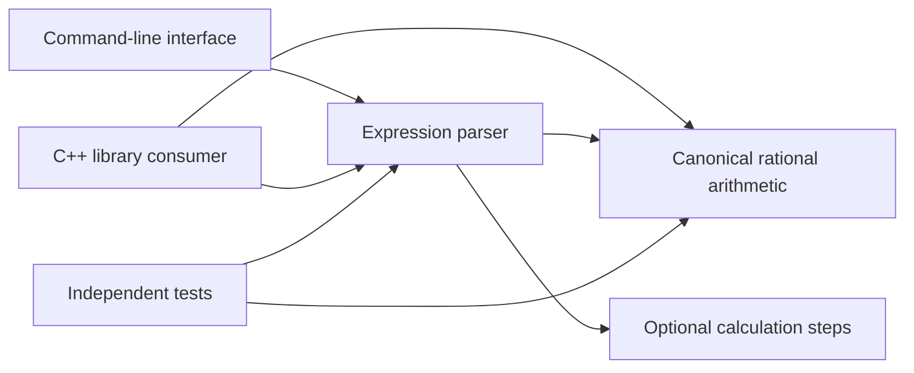

# Engineering notes

## Architecture



The public headers expose standard C++20 types. `rational.cpp` owns numeric normalization and range checks. `expression.cpp` owns grammar, precedence, resource bounds and error positions. `app/main.cpp` handles command arguments, terminal-safe diagnostics and exit codes. The library does not print or access files.

## Canonical representation

A Rational stores a signed 64-bit numerator and a strictly positive signed 64-bit denominator. Numerator and denominator have no common factor; zero is always `0/1`. Equality can therefore compare the stored pair directly.

Normalization calculates sign separately from unsigned magnitudes. This avoids negating the most negative signed integer in its own type. A zero denominator is rejected before the zero-numerator shortcut.

Operations use GCC/Clang's 128-bit integer extension internally, reduce the result, then check whether the normalized values fit the public 64-bit representation. This accepts products whose unreduced numerator or denominator exceeds 64 bits when the reduced result fits.

For valid stored inputs, each numerator magnitude is at most 2^63 and each denominator is at most 2^63 - 1. Multiplication and division require products below or equal to 2^126 in magnitude. Addition/subtraction combine two numerator-denominator cross products whose total magnitude is bounded by 2^127 - 2^64, inside the signed 128-bit range. Decimal conversion accumulates at most 37 digits, below 10^37 and therefore below the same intermediate range. Comparisons use cross products without narrowing.

Subtraction is implemented directly, not by first negating the right operand: `INT64_MIN - INT64_MIN` is representable even though `-INT64_MIN` is not representable as a Rational.

The cost of bounded exact arithmetic is explicit overflow. This library does not provide arbitrary precision, symbolic simplification across overflowing subexpressions, floating-point estimates or tolerance-based equality.

## Parsing and diagnostics

The recursive-descent grammar is:

```text
expression := term (("+" | "-") term)*
term       := unary (("*" | "/") unary)*
unary      := ("+" | "-") unary | primary
primary    := number | "(" expression ")"
number     := digits ("." digits?)? | "." digits
```

ASCII whitespace is accepted between tokens. The parser consumes the complete input; it rejects trailing tokens and unsupported syntax rather than guessing. It never invokes a shell, evaluates C++ code or calls a language interpreter.

A sign immediately applied to a numeric literal is parsed with that literal, allowing the negative 64-bit minimum without requiring its unrepresentable positive magnitude. The documented range still applies at every other evaluated subexpression.

Input length, token count and nesting limits bound work and stack depth. Arithmetic errors are reported at the relevant operator or literal. `ExpressionError::position()` points into the original input; the CLI prints a bounded excerpt and replaces control bytes with spaces before writing to the terminal.

When tracing is enabled, unary and binary calculations record their original source slice and exact result in evaluation order. Parentheses determine grouping but do not add artificial computation steps. An expression containing only a literal has no operation steps. These traces explain evaluation, not symbolic algebra.

## Testing strategy

Boundary tests cover both signed integer extremes, negative denominators, zero denominators, normalization, reduction before range checking, malformed literals and overflow. Small randomized fractions are checked with independently calculated integer numerators and denominators; a fixed seed makes failures reproducible.

The Python differential suite generates its own expression trees and expected values using `fractions.Fraction`. This supplies a separate implementation and arbitrary-precision oracle for bounded test expressions. CLI checks verify unequal-answer status, diagnostics and source pointers as well as arithmetic output.

A second Python oracle checks 512 full-width cases with independently normalized,
representable operands. Only the final operation may exceed the public range.
Expected results use arbitrary-precision fractions, including cases where large
products cancel, where the reduced numerator or denominator overflows, and where
the divisor is zero. CLI checks also pass a read-only stdout descriptor to every
output-producing command to ensure write failures return status 2.

Sanitizer builds use AddressSanitizer and UndefinedBehaviorSanitizer. CI also tests a separate compiler family so compiler-specific behavior is less likely to go unnoticed. Python is a test tool only; the library and CLI have no Python runtime dependency.

## Installation

The shared-library CLI records an install-time runtime search path relative to
its executable (`@loader_path` on macOS and `$ORIGIN` on Linux). The path is
computed from the configured binary and library directories. Exported headers
use `CMAKE_INSTALL_INCLUDEDIR` rather than assuming `include`. Relative install
directories allow the installed tree to move as a unit; absolute directories
refer to fixed configured locations.

The installation test moves the installed tree before running its CLI and
building a separate consumer. Shared-library CI jobs use `tools/bin`, `lib64`,
and `headers` to exercise custom locations. The isolated test is skipped for
absolute destinations because `cmake --install --prefix` cannot redirect those
paths into the test's scratch directory.

## Current boundaries

- Supported toolchains need C++20 and 128-bit integer intermediates. The build checks that extension explicitly; native MSVC is outside the current support scope.
- The expression API uses bytes and ASCII syntax, not Unicode mathematical notation.
- The CLI evaluates numeric expressions; it does not solve equations containing unknowns.
- Exact equality rejects close approximations. A future tolerance policy would need a separate API and tests, rather than changing exact equality silently.
- No network calls, user accounts, persistence, analytics or model-training facilities are part of this project.
