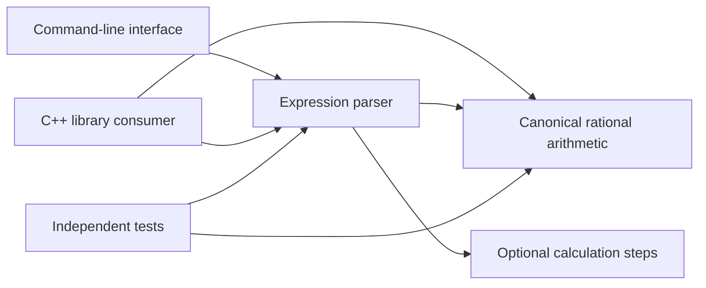

# Engineering notes

## Architecture



The public headers expose standard C++20 types. `rational.cpp` owns numeric normalization and range checks. `expression.cpp` owns grammar, precedence, resource bounds and error positions. `app/main.cpp` handles command arguments, terminal-safe diagnostics and exit codes. The library does not print or access files.

## Canonical representation

A Rational stores a signed 64-bit numerator and a strictly positive signed 64-bit denominator. Numerator and denominator have no common factor; zero is always `0/1`. Equality can therefore compare the stored pair directly.

Normalization calculates sign separately from unsigned magnitudes. This avoids negating the most negative signed integer in its own type. A zero denominator is rejected before the zero-numerator shortcut.

Operations use GCC/Clang's 128-bit integer extension internally, reduce the result, then check whether the normalized values fit the public 64-bit representation. This accepts products whose unreduced numerator or denominator exceeds 64 bits when the reduced result fits. The checked pair is stored as it is: passing it through the public constructor would reduce it a second time.

For valid stored inputs, each numerator magnitude is at most 2^63 and each denominator is at most 2^63 - 1. Multiplication and division require products below or equal to 2^126 in magnitude. Addition/subtraction combine two numerator-denominator cross products whose total magnitude is bounded by 2^127 - 2^64, inside the signed 128-bit range. Decimal conversion accumulates at most 37 digits, below 10^37 and therefore below the same intermediate range. It checks the literal's syntax before its digit and length limits, so malformed text always throws `std::invalid_argument`, and only a well-formed literal can exceed a limit (`std::overflow_error`). Comparisons use cross products without narrowing.

Subtraction is implemented directly, not by first negating the right operand: `INT64_MIN - INT64_MIN` is representable even though `-INT64_MIN` is not representable as a Rational.

The cost of bounded exact arithmetic is explicit overflow. This library does not provide arbitrary precision, symbolic simplification across overflowing subexpressions, floating-point estimates or tolerance-based equality.

## Parsing and diagnostics

The recursive-descent grammar is:

```text
expression := term (("+" | "-") term)*
term       := unary (("*" | "/") unary)*
unary      := ("+" | "-") unary | primary
primary    := number | "(" expression ")"
number     := digits ("." digits?)? | "." digits
```

ASCII whitespace is accepted between tokens. The parser consumes the complete input; it rejects trailing tokens and unsupported syntax rather than guessing. It never invokes a shell, evaluates C++ code or calls a language interpreter.

A sign immediately applied to a numeric literal is parsed with that literal, allowing the negative 64-bit minimum without requiring its unrepresentable positive magnitude. The documented range still applies at every other evaluated subexpression.

Input length, token count and nesting limits bound work and stack depth. Arithmetic errors are reported at the relevant operator or literal. `ExpressionError::position()` points into the original input; the CLI prints a bounded excerpt and replaces control bytes with spaces before writing to the terminal. `equivalent()` evaluates its left operand first and throws `OperandError`, which names the operand that the position refers to.

When tracing is enabled, unary and binary calculations record their original source slice and exact result in evaluation order. Parentheses determine grouping but do not add artificial computation steps. An unsigned literal alone has no operation steps. An explicit sign is a unary operation, so `-5` records `-5 = -5` and `+5` records `+5 = 5`, including when the parser reads the sign and numeric magnitude together. These traces explain evaluation, not symbolic algebra.

A slice includes the slices of the operations inside it, so in a left-associative chain every step repeats the text before it. Within the input limits, a 4,096-byte chain padded with spaces would record about 1.8 MB of slices. Traced evaluation therefore records only the first steps whose slices total at most 65,536 bytes (`max_explanation_length`) and counts the operations after them in `Evaluation::omitted_steps`, which the CLI prints in an `Omitted steps` line. The value is complete either way: tracing never rejects an expression that untraced evaluation accepts.

## Testing strategy

Boundary tests cover both signed integer extremes, negative denominators, zero denominators, normalization, reduction before range checking, malformed literals and overflow. Small randomized fractions are checked with independently calculated integer numerators and denominators; a fixed seed makes failures reproducible. The operands are taken directly from the standard-specified `std::mt19937` sequence rather than through `std::uniform_int_distribution`, whose algorithm differs between standard libraries, so every platform tests the same pairs, and a failure names the pair.

The Python differential suite generates its own expression trees and expected values using `fractions.Fraction`. This supplies a separate implementation and arbitrary-precision oracle for bounded test expressions. The trees include signed operands, and each is printed with only the parentheses that precedence and left associativity require, plus random redundant parentheses and ASCII whitespace, so a parser that groups operations differently gets a different result. CLI checks verify arithmetic output, unequal-answer status, diagnostics and source pointers (including bounded excerpts of long input), and that error excerpts and calculation steps print control and non-ASCII bytes as spaces.

A second Python oracle checks 512 full-width cases with independently normalized,
representable operands. Only the final operation may exceed the public range.
Expected results use arbitrary-precision fractions, including cases where large
products cancel, where the reduced numerator or denominator overflows, and where
the divisor is zero. CLI checks also pass a read-only stdout descriptor to every
output-producing command to ensure write failures return status 2. For a write
to a closed pipe, the CLI keeps the conventional Unix `SIGPIPE` termination
instead (status 141 in a shell).

Sanitizer builds use AddressSanitizer and UndefinedBehaviorSanitizer. CI also tests a separate compiler family so compiler-specific behavior is less likely to go unnoticed. Python is a test tool only; the library and CLI have no Python runtime dependency.

## Installation

The shared-library CLI records an install-time runtime search path relative to
its executable (`@loader_path` on macOS and `$ORIGIN` on Linux). The path is
computed from the configured binary and library directories. Exported headers
use `CMAKE_INSTALL_INCLUDEDIR` rather than assuming `include`. Relative install
directories allow the installed tree to move as a unit; absolute directories
refer to fixed configured locations.

A shared library is compiled with hidden visibility, and the public headers mark
the exported API with `AXIOM_MATH_API`. It therefore exports the same symbols
whatever visibility preset or flags a parent project uses. A static library has
nothing to export. It is compiled with the visibility of the project that builds
it, and CMake defines `AXIOM_MATH_STATIC` for it and for everything that links it,
which leaves `AXIOM_MATH_API` empty. A plugin or shared library that links it and
hides its symbols therefore hides AxiomMath's as well, instead of exporting a copy
that another module's AxiomMath could interpose. The CLI has
its own export set: the package configuration imports `AxiomMath::axiom-math`
only when the installed executable exists, so a library-only installation still
loads. A project that embeds AxiomMath with `add_subdirectory` builds only the
library unless it sets `AXIOM_MATH_BUILD_CLI`, `AXIOM_MATH_BUILD_TESTS` or
`AXIOM_MATH_INSTALL`.

The installation test moves the installed tree before running its CLI and
building a separate consumer, which finds the package from `CMAKE_PREFIX_PATH`
alone, as the README describes. Under a prefix, `find_package` searches `lib`,
`lib/<arch>` and `share` on every host but `lib64` only on platforms that use it
(not Debian-family Linux), so the package is installed beside the library only in
those directories, and in `share/cmake/AxiomMath` otherwise. That fallback is the
literal `share` directory, not `CMAKE_INSTALL_DATADIR`, because the search does not
follow a data directory that is set elsewhere. Shared-library CI jobs use
`tools/bin`, `lib64`, and `headers` to exercise custom locations, and the Linux
one also sets a data directory that the package must not follow. The isolated
test is skipped for absolute destinations because `cmake --install --prefix`
cannot redirect those paths into the test's scratch directory.

The nested projects of the installation and embedding tests use the main build's
generator and load as initial cache its toolchain file and the variables that file
declares for nested projects, its build tool, its compiler with any launcher,
target, external toolchain, sysroot and linker type, its compile and link flags
and standard libraries, and its Apple architecture settings, so they build in the
same configuration. Both tests ignore `DESTDIR` and `CMAKE_INSTALL_MODE` from the
environment: these would stage the installations elsewhere, or install symbolic
links to build-tree programs that still find their library through build-time
runtime paths. CTest runs both tests with these variables set to check that they
are ignored.

After that consumer passes, the installation test deletes the installed CLI and
configures the consumer again. A separate test embeds the source tree in a
parent project that builds shared libraries with hidden default visibility; the
parent must link and run, and build and install nothing else from AxiomMath.
The same parent then embeds AxiomMath as a static library and builds a plugin
that links it: the loaded plugin must work and export its own entry point, but
none of AxiomMath's symbols.

## Current boundaries

- Supported toolchains need C++20 and 128-bit integer intermediates. The build checks that extension explicitly; native MSVC is outside the current support scope.
- The expression API uses bytes and ASCII syntax, not Unicode mathematical notation.
- The CLI evaluates numeric expressions; it does not solve equations containing unknowns.
- Exact equality rejects close approximations. A future tolerance policy would need a separate API and tests, rather than changing exact equality silently.
- No network calls, user accounts, persistence, analytics or model-training facilities are part of this project.
